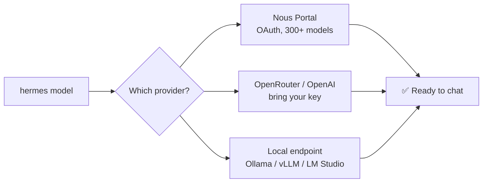

# HERMES AGENT — WINDOWS SETUP RITUAL 


### _"The agent that grows with you"_ — Nous Research

```
    __  __ ______ ____  __  __ ______  _____
   / / / // ____// __ \/ / / // ____/ / ___/
  / /_/ // __/  / /_/ / /_/ // __/    \__ \
 / __  // /___ / _, _/ __  // /___   ___/ /
/_/ /_//_____//_/ |_/_/ /_//_____/  /____/

>>> AUTONOMOUS. PERSISTENT. YOURS. <<<
```

> [!TIP] You're not installing a chatbot. You're standing up a **persistent AI operator** — one that can run on a $5 VPS, talk to you over Telegram while it grinds away on a cloud box you never SSH into, remember everything across sessions, and _write its own skills_ when it figures something out. Let's get it running on Windows. 🚀

---

## STEP 0 — PICK YOUR WINDOWS PATH

Two ways in on Windows. Pick based on how much you trust "experimental":

|Path|Support level|Best for|
|---|---|---|
|🪟 **Native Windows**|Fully supported — PowerShell one-liner installs everything|People who want zero extra layers|
|🐧 **WSL2**|Battle-tested, same install path as Linux|People who want the smoothest, most-documented ride|

<details> <summary><b>🤔 Not sure which to pick? Click to expand</b></summary> <br>

Native Windows installs live under `%LOCALAPPDATA%\hermes`. WSL2 installs live under `~/.hermes`, same as on Linux. If you're already comfortable in a Linux-style shell, WSL2 has the deepest community documentation. If you want the least friction and don't mind being an early adopter, native Windows works great too.

</details>

> [!WARNING] If your antivirus (Bitdefender, Windows Defender, etc.) quarantines `uv.exe` from the Hermes bin folder — that's a **false positive**. It's just Astral's `uv`, the Rust-based Python package manager Hermes bundles. ML-based AV engines commonly flag unsigned Rust binaries that download packages.

---

## STEP 1 — INSTALL

### 🪟 Option A: Native Windows (PowerShell)

```powershell
irm https://hermes-agent.nousresearch.com/install.ps1 | iex
```

This one-liner installs everything: `uv`, Python 3.11, the Hermes CLI, and the desktop app if you want it.

### 🐧 Option B: WSL2

```bash
curl -fsSL https://hermes-agent.nousresearch.com/install.sh | bash
```

### 🔒 Option C: Pin an exact version (audit-friendly)

```bash
git clone --depth 1 --branch v2026.7.1 https://github.com/NousResearch/hermes-agent.git
cd hermes-agent
uv venv .venv --python 3.11
uv pip install -e .
```

**Verify it worked:**

```bash
hermes --version
```

> [!NOTE] If `hermes` isn't found, restart your terminal or re-source your profile. The installer updates PATH, but your _current_ session doesn't know that yet.

---

## STEP 2 — THE SETUP WIZARD

```bash
hermes setup
```

Pick your difficulty:

- [ ]  **Quick Setup (Nous Portal)** — free OAuth, zero API keys, model + full Tool Gateway (web search, image gen, TTS, cloud browser) in one shot
- [ ]  **Full Setup** — bring your own keys, configure every provider/tool by hand
- [ ]  **Blank Slate** — bare minimum: provider, model, File Ops + Terminal only

Coming from **OpenClaw**? Hermes auto-detects `~/.openclaw` and offers to migrate:

```bash
hermes claw migrate --dry-run     # preview first, always
hermes claw migrate               # full interactive migration
```

---

## STEP 3 — CHOOSE YOUR BRAIN

```bash
hermes model
```

Model-agnostic by design — Nous Portal (300+ models), **OpenRouter, OpenAI, Anthropic, DeepSeek, xAI**, or a local model via **Ollama/vLLM/LM Studio**. Swap anytime, zero code changes.



<details> <summary><b>🖥️ Running local models on Windows/WSL2? Click for the setup</b></summary> <br>

1. Start your local model server, exposing an OpenAI-compatible `/v1` endpoint
2. Run `hermes model` → choose **custom endpoint**
3. Enter the base URL, model name, and key if required
4. Set context to **at least 64K tokens** — local setups need the headroom

</details>

---

## STEP 4 — FIRST CONTACT

```bash
hermes
```

Throw it something real immediately:

```
> Summarize this repo in 5 bullets and tell me what the main entrypoint is.
> Check my current directory and tell me what looks like the main project file.
> What's my disk usage? Show the top 5 largest directories.
```

If it runs commands and gives real answers back — **you're past the hardest part** 🎉

```bash
hermes          # classic prompt_toolkit CLI
hermes --tui     # modal-overlay TUI with mouse support
```

---

## STEP 5 — GIVE IT A VOICE (the Gateway)

```bash
hermes gateway setup
```

20+ platforms — Telegram, Discord, Slack, WhatsApp, Signal, Email, SMS, Matrix, Teams, LINE, Google Chat, Home Assistant — all through **one gateway process**, all sharing the same context.

```bash
hermes gateway run        # foreground, for testing
hermes gateway install    # runs as a background service
hermes gateway status     # is it alive?
```

> [!IMPORTANT] Don't connect a shared platform until you've stress-tested the exact model, tools, and permissions locally. Convenience widens the blast radius.

---

## STEP 6 — LET IT LEARN (Skills + Memory)

This is what makes Hermes _Hermes_. When it solves something hard, it writes itself a reusable skill — searchable, shareable, and compatible with the open `agentskills.io` standard.

```bash
hermes memory setup       # configure the persistent memory layer
hermes insights --days 7  # see what it's been learning
```

---

## STEP 7 — PLUG IN THE UNIVERSE (MCP)

```bash
hermes mcp install <name>
```

Auto-discovers tools over stdio or HTTP. Add subagent delegation for real parallel firepower:

```bash
hermes kanban init     # spin up a multi-agent work queue
```

---

## 🛡️ Harden It Before You Trust It

- [ ] Prove the first chat works
- [ ] Verify session resume actually resumes
- [ ] Add skills and gateways **slowly**, one at a time
- [ ] Run it in Docker or an isolated environment for anything with system access
- [ ] Keep credentials scoped — don't hand it root-level secrets out of laziness

> [!CAUTION] Built-in protections help (credential stripping from child processes, cross-session isolation, container sandboxing) — but they're not a substitute for scoping access yourself.

---

## 🩺 Troubleshooting

<details> <summary><b><code>hermes</code> command not found after install</b></summary> <br>

Restart your terminal, or manually re-source your shell profile. The installer edits PATH but doesn't refresh your current session.

</details> <details> <summary><b>Antivirus quarantined uv.exe</b></summary> <br>

False positive — it's Astral's `uv`, an unsigned Rust binary that downloads packages, which trips ML-based AV heuristics. Safe to allow.

</details> <details> <summary><b>Something's just broken and I don't know why</b></summary> <br>

```bash
hermes doctor
```

This is the "known good state" button. Run it first, always.

</details>

---

## 🧰 Command Cheat Sheet

```bash
hermes                  # start a conversation
hermes model            # choose provider/model
hermes tools            # configure enabled tools
hermes gateway          # messaging gateway control
hermes setup            # full setup wizard
hermes claw migrate     # migrate from OpenClaw
hermes update           # update to latest
hermes doctor           # diagnose what's broken
hermes memory status    # check memory health
hermes dashboard        # web admin panel
hermes proxy            # OpenAI-compatible local proxy
```

---

## 🎯 The Mindset

> Install it cleanly. Pick one reliable model. Prove the first chat works. Verify session resume. Add skills and gateways slowly. Use Docker for anything risky. Keep credentials scoped. **Then** let it handle real workflows.

That's the difference between _playing with_ an agent and _operating_ one.

---

**<p align="center"><i>Docs: hermes-agent.nousresearch.com/docs · Repo: github.com/NousResearch/hermes-agent</i></p>

<p align="left">     </p>
