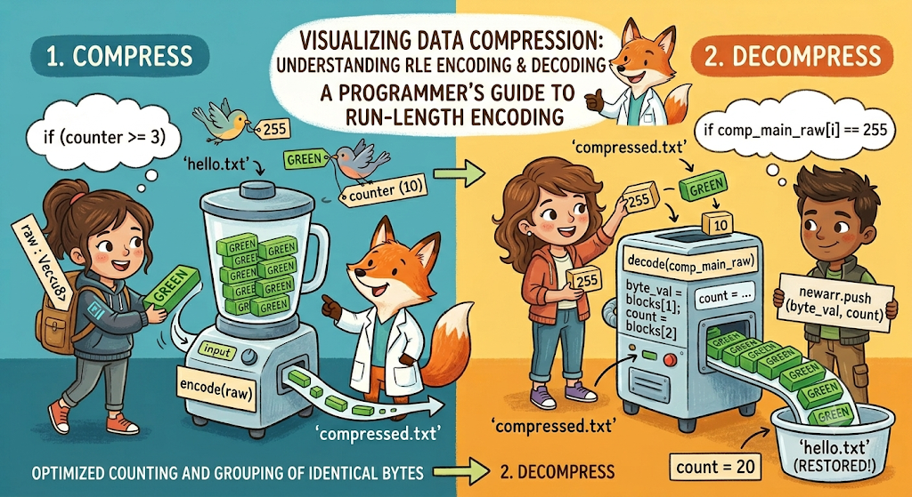

## SHORT GLIMPES ON COMPRESIION SOFTWARES AND ALGORITHMS 

Compression Algorithms have existed for a long time. It began as an attempt to reduce the file size because storing information was a difficult and expensive task in earlier days of computing. Nowadays we get storing information is not a huge task but rather sending information from one computer to another has gotten verry expensive. Sending bulks of  information in the internet has also caused spikes in energy consumption. Thus In order to push my innovation to the limits I take my time off to learn about Compression.

## FEW TERMS TO KNOW:

1. **Compression ratio**:  It is size of compressed file divided by size of original file
2. **WinZip, WinRAR, 7zip**: Examples of compression software
3. **LOSSY and LOSSLESS COMPRESSION** : Compression algorithms that loose or not loose the pixels of image after compression
4. **RUN LENGTH ENCODDING**: A algorithm used for lossless compression
5. **DICTIONARY ENCODDING**: A algorithm that assigns the parts of the file binary values that are arranged in the descending order according to the number of times it occurs in the file.
6. **HUFFMAN CODDING**: A algorithm that uses binary tree to compress data

## ALGORITHMS


They are dived into two types depending upon whether the compression algorithms loose or not loose the pixels of image after compression

- lossy
- lossless

Here are examples of Lossless algorithms:

- RUN LENGTH ENCODDING
- DICTIONARY ENCODDING
- HUFFMAN CODDING

For now I'll be focusing on **RUN LENGTH ENCODING (RLE)**





# Functions Required
| **Function Name** | **Primary Purpose**                                                                                                                                                  |
| ----------------- | -------------------------------------------------------------------------------------------------------------------------------------------------------------------- |
| `main`            | Handles user interaction, coordinates file I/O operations, and routes execution to either compression or decompression based on user input.                          |
| `encode`          | Compresses raw byte data using Run-Length Encoding (RLE), replacing repeating byte sequences greater than 3 with a specific compressed format (`255`, value, count). |
| `decode`          | Decompresses the RLE-encoded byte stream back into its original raw state by expanding the marker-based compressed sequences.                                        |

## RUN LENGTH ENCODDING

First i want to Show you one example (a basic picture) of how this algorithm looks like 


**example**:
PAAAAANDA
**after applying the algorithm**:
P5ANDA

**example**:
WWWWWAAAAHHH
**after applying the algorithm**:
5W4A3H


Of course this is just a basic picture of what this algorithm does. This has been implemented in several ways throughout history.

My implementation of this algorithm is as shown 


## STARTING STEPS OF THE PROJECT
create project directory.
create the projects with these commands.

```bash
cargo init
```

```bash
cargo run
```


# import statements
```rust
use std::fs::File;

use std::io::{BufReader, Read};
```

# main
```rust
fn main() {

    println!("This is a simple RLE compression and decompression program.");

    println!("It reads data from 'hello.txt', compresses it using RLE, and writes the compressed data to 'compressed.txt'.");

    println!("Then it reads the compressed data, decompresses it, and writes the original data back to 'hello.txt'.");

    println!("choose the option");

    println!("1. Compress");

    println!("2. Decompress");

    let mut choice = String::new();
    std::io::stdin().read_line(&mut choice).unwrap();

    if choice.trim() == "1"{
	    let file= File::open("hello.txt").unwrap();
	    let mut reader_buffer = BufReader::new(file);
	    let mut raw : Vec<u8> = Vec::new();
	    reader_buffer.read_to_end(&mut raw).unwrap();
	    println!("main Data: {:?}", raw.len());
	    let newarr = encode(raw);
	    std::fs::write("compressed.txt", &newarr).unwrap();
	    println!("Compressed Pixel Data: {:?}", newarr.len());
    }
    else if choice.trim() == "2"{
	    let compfile= File::open("compressed.txt").unwrap();
	    let mut comp_reader_buffer = BufReader::new(compfile);
	    let mut comp_raw : Vec<u8> = Vec::new();
	    comp_reader_buffer.read_to_end(&mut comp_raw).unwrap();
	    let comp_main_raw: &[u8] = &comp_raw[..];
	    let decomp_arr = decode(comp_main_raw);
	    std::fs::write("hello.txt", &decomp_arr).unwrap();
  
    }
    else{
        print!("Invalid choice. Please choose either 1 or 2.");
    };
}
```

# encode
```rust
fn encode(raw: Vec<u8>)-> Vec<u8>{
    let mut newarr : Vec<u8> = Vec::new();
    let mut counter: u8 = 0;  
    let pixdata: &[u8] = &raw[..];
    let mut prev: u8 =raw[0];
    for byte in  pixdata {
        if prev == *byte{
            counter += 1;
            continue;
        }
        else{
            if counter > 3{
                newarr.push(255);
                newarr.push(prev);
                newarr.push(counter);
            } else {
                for _ in 0..counter {
                    newarr.push(prev);
                }
            prev = *byte;
            counter = 0;
        }
        newarr.push(prev);
    }
    if counter > 3{
            newarr.push(255);
            newarr.push(prev);
            newarr.push(counter);
            }
    else if counter > 1{
        for _ in 0..counter {
            newarr.push(prev);
        }
            };
    return newarr;
}
```

# decode
```rust
fn decode(comp_main_raw: &[u8])-> Vec<u8>{  
    let mut comp_newarr: Vec<u8> = Vec::new();
    let mut i = 0;
    while i < comp_main_raw.len() {
        if comp_main_raw[i] == 255 {
            let byte_val = comp_main_raw[i + 1];
            let count = comp_main_raw[i + 2];
            for _i in 0..count {
                comp_newarr.push(byte_val);
            }
            i += 3;
        } else {
            comp_newarr.push(comp_main_raw[i]);
            i += 1;
        }
    }
    return comp_newarr;
}
```


# What it does
- It takes text from hello.txt
- turns it into vector of bytes represented by unassigned integers
- when repeating pattern arises it adds byte represented 255 in from of it then add the byte and then the amount of times it is repeated
- while decoding when we see a 255 unassigned integer then we take the next byte and repeat entering that byte for n times which is specified in the next byte.
